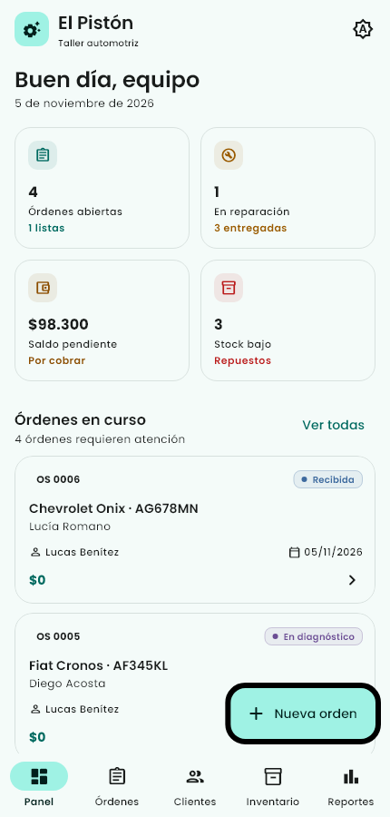
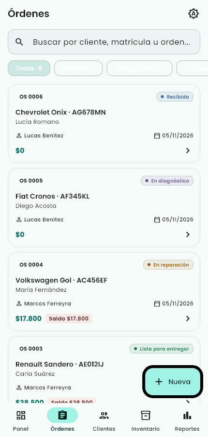
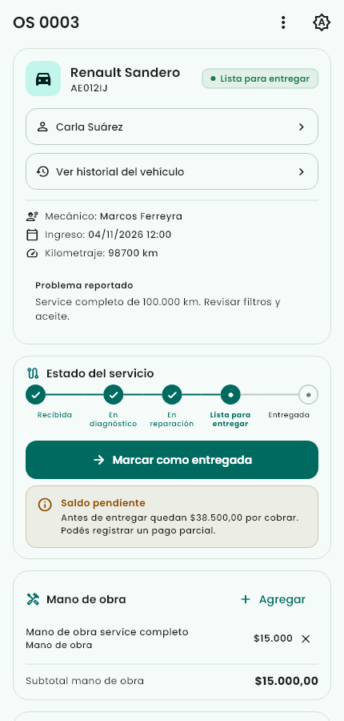
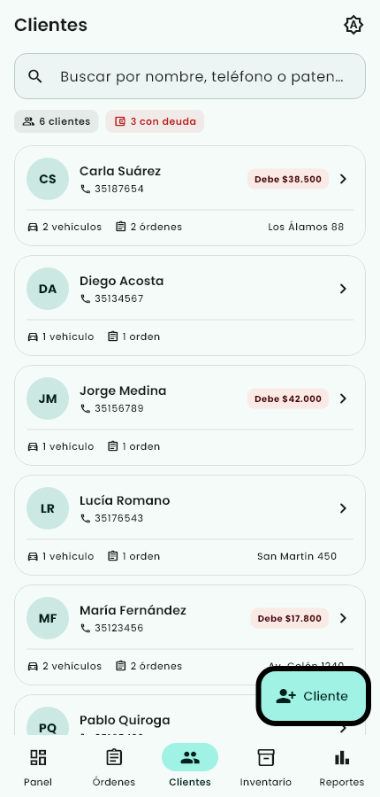
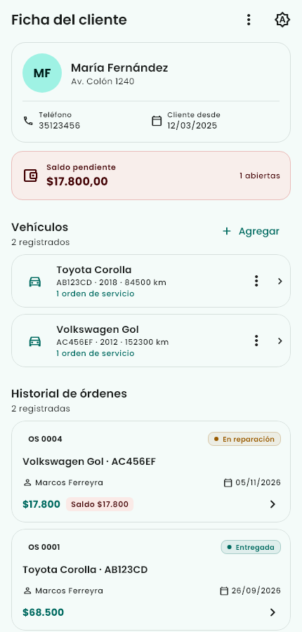
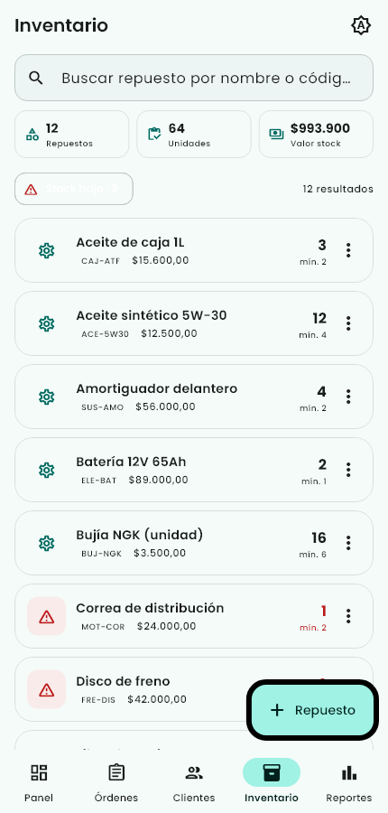
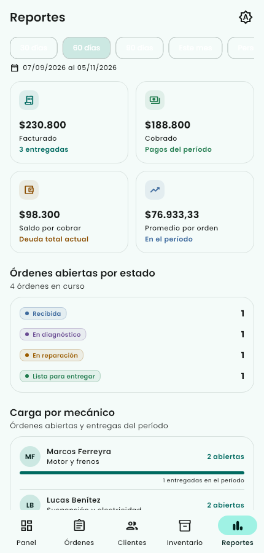
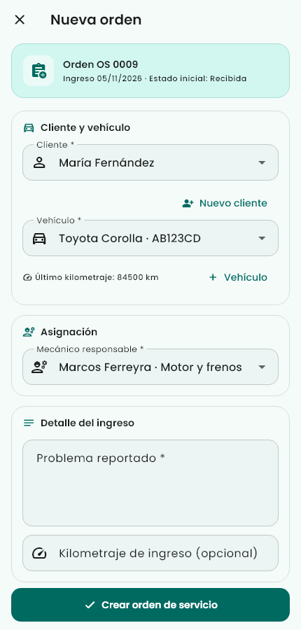
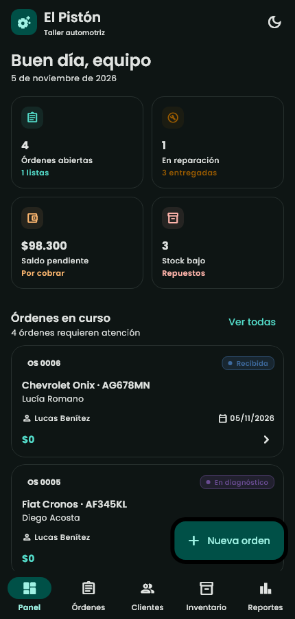

# El Pistón

Aplicación **Android** para la gestión integral del taller automotriz **El Pistón**. Está desarrollada con **Flutter + Drift/SQLite**, funciona **100 % offline** y conserva todos los datos aunque se cierre la aplicación.

El proyecto toma los patrones de arquitectura de la aplicación de referencia **turco**: `ChangeNotifier` como base de los ViewModels, `ListenableBuilder` para reaccionar a los cambios, `go_router` para la navegación, tema centralizado y una clara separación entre vistas, estado y persistencia.

> **Entrega:** trabajo práctico de desarrollo móvil.
> **APK:** se compila localmente; no se incluye en el repositorio.
> **Capturas:** [`capturas/`](capturas/)
> **Arquitectura detallada:** [`docs/ARQUITECTURA.md`](docs/ARQUITECTURA.md)

---

## Índice

- [Resumen funcional](#resumen-funcional)
- [Capturas](#capturas)
- [Tecnologías](#tecnologías)
- [Arquitectura MVVM](#arquitectura-mvvm)
- [Persistencia con Drift y SQLite](#persistencia-con-drift-y-sqlite)
- [Modelo de datos](#modelo-de-datos)
- [Reglas de negocio](#reglas-de-negocio)
- [Reportes](#reportes)
- [Datos de demostración](#datos-de-demostración)
- [Estructura del proyecto](#estructura-del-proyecto)
- [Pruebas](#pruebas)
- [Compilación y ejecución](#compilación-y-ejecución)
- [Decisiones de diseño](#decisiones-de-diseño)
- [Alcance y limitaciones](#alcance-y-limitaciones)

---

## Resumen funcional

| Módulo | Qué permite hacer |
|---|---|
| **Panel** | Ver el pulso del taller: órdenes abiertas, entregas, facturación, saldo pendiente, stock bajo y últimas órdenes. |
| **Órdenes** | Crear órdenes de servicio, buscarlas por cliente/patente/problema, filtrarlas por estado y avanzar el flujo de trabajo. |
| **Detalle de orden** | Cargar mano de obra, agregar repuestos con descuento de stock, registrar pagos parciales, consultar totales y saldo, y cambiar de estado. |
| **Clientes** | Alta, edición y eliminación de clientes; un cliente puede tener varios vehículos. Ficha con deuda, vehículos e historial. |
| **Vehículos** | Ficha con datos del rodado e historial completo de órdenes. |
| **Inventario** | Alta, edición y eliminación de repuestos, control de existencias, precios y alertas de stock mínimo. |
| **Reportes** | Facturación, cobranza, saldo, ticket promedio, órdenes por estado, carga por mecánico, deudas por cliente y stock bajo. |
| **Tema** | Modo claro y oscuro con preferencia durante la sesión. |
| **Persistencia** | Base SQLite local; los cambios se guardan automáticamente y sobreviven al cierre de la app. |

### Flujo de una orden

```
Recibida → En diagnóstico → En reparación → Lista para entregar → Entregada
     └────────────────── cancelación (solo sin pagos) ──────────────────┘
```

La cancelación devuelve al inventario los repuestos que se habían descontado. Una orden entregada o cancelada queda cerrada y no admite más cambios.

---

## Capturas

Las imágenes fueron generadas desde la aplicación real con el tema y las fuentes del proyecto, a un tamaño de 430 × 900 px.

| Panel | Órdenes |
|---|---|
|  |  |

| Detalle de orden | Clientes |
|---|---|
|  |  |

| Ficha de cliente | Inventario |
|---|---|
|  |  |

| Reportes | Nueva orden |
|---|---|
|  |  |

| Panel en modo oscuro |
|---|
|  |

---

## Tecnologías

| Componente | Versión / uso |
|---|---|
| Flutter | 3.47.3 |
| Dart | 3.13.3 |
| Drift | 2.31.0 |
| drift_flutter | 0.2.8 |
| SQLite | `sqlite3` 2.9.4 / `sqlite3_flutter_libs` 0.5.42 |
| go_router | 16.2.4 |
| Fuente | Poppins (400, 500, 600, 700) |
| Diseño | Material 3, tema claro/oscuro, locale `es_AR` |
| Plataforma | Android (sin web ni escritorio) |

Las dependencias de Drift y de la cadena nativa están fijadas a versiones concretas para que la generación de código y la compilación sean reproducibles.

---

## Arquitectura MVVM

La aplicación sigue el mismo esquema que **turco**:

```
Vista (Stateless/StatefulWidget)
        │  escucha con ListenableBuilder
        ▼
ViewModel (ChangeNotifier)
        │  lee y ejecuta acciones
        ▼
AppState (ChangeNotifier, fuente de verdad)
        │  fotografía inmutable
        ▼
RepositorioTaller (interfaz)
        ├── RepositorioDrift  → Drift → SQLite
        └── RepositorioMemoria → pruebas
```

### Responsabilidades

- **Vista:** solo construye la interfaz, muestra datos y delega acciones. No calcula reglas de negocio ni escribe en la base.
- **ViewModel:** adapta el estado a lo que necesita una pantalla: filtros, búsquedas, agrupaciones y métricas derivadas. Notifica a la UI mediante `notifyListeners()`.
- **AppState:** concentra las reglas del taller (validaciones, transiciones, stock, pagos, reportes). Es la única fuente de verdad en memoria.
- **Repositorio:** abstrae la persistencia. La app de producción usa `RepositorioDrift`; las pruebas pueden usar `RepositorioMemoria`.

### ViewModels incluidos

| ViewModel | Pantalla / responsabilidad |
|---|---|
| `PanelViewModel` | Indicadores del panel y órdenes recientes. |
| `OrdenesViewModel` | Búsqueda, filtro por estado y listado de órdenes. |
| `OrdenDetalleViewModel` | Acciones y totales de una orden. |
| `OrdenFormViewModel` | Validación y creación de una orden nueva. |
| `ClientesViewModel` | Búsqueda de clientes por nombre o patente. |
| `ClienteDetalleViewModel` | Vehículos, órdenes y saldo de un cliente. |
| `VehiculoDetalleViewModel` | Historial de un vehículo. |
| `InventarioViewModel` | Búsqueda, stock bajo y valor del inventario. |
| `ReportesViewModel` | Períodos, métricas y reportes del negocio. |
| `FormulariosViewModel` | Estado de los formularios de cliente y repuesto. |

La navegación usa `StatefulShellRoute.indexedStack` con cinco ramas (Panel, Órdenes, Clientes, Inventario, Reportes), de modo que cada pestaña conserva su estado. Las rutas de detalle y de alta viven fuera del shell: `/nueva-orden`, `/orden/:id`, `/cliente/:id`, `/vehiculo/:id`.

---

## Persistencia con Drift y SQLite

La base se abre con `driftDatabase(name: 'el_piston')`, sobre SQLite nativo de Android. El esquema está declarado en [`lib/data/base_datos.dart`](lib/data/base_datos.dart) y el código se genera con `drift_dev` + `build_runner`.

### Estrategia de guardado

1. `AppState` mantiene las listas en memoria para que la interfaz responda de inmediato.
2. Cada mutación llama a `_cambio()`: notifica a la UI y encola una **fotografía** de `DatosTaller`.
3. Las escrituras se serializan en una cola (`_colaGuardado`) para que nunca se ejecuten dos transacciones a la vez.
4. `RepositorioDrift.guardar()` reemplaza el contenido de todas las tablas dentro de **una única transacción atómica**. Si algo falla, la base anterior queda intacta.
5. Al iniciar, `AppState.cargar()` intenta leer la base. Si está vacía (primer arranque) o dañada, siembra los datos de demostración y los persiste.

La integridad referencial está activada explícitamente:

```sql
PRAGMA foreign_keys = ON;
```

### Esquema SQL real

Drift genera estas tablas y restricciones (se muestran sin el `sqlite_sequence` interno):

```sql
CREATE TABLE mecanicos (
  id TEXT NOT NULL PRIMARY KEY,
  nombre TEXT NOT NULL,
  especialidad TEXT NOT NULL
);

CREATE TABLE clientes (
  id TEXT NOT NULL PRIMARY KEY,
  nombre TEXT NOT NULL,
  telefono TEXT NOT NULL,
  direccion TEXT NULL,
  creado_en INTEGER NOT NULL
);

CREATE TABLE vehiculos (
  id TEXT NOT NULL PRIMARY KEY,
  id_cliente TEXT NOT NULL REFERENCES clientes(id) ON DELETE CASCADE,
  matricula TEXT NOT NULL UNIQUE,
  marca TEXT NOT NULL,
  modelo TEXT NOT NULL,
  anio INTEGER NOT NULL,
  kilometraje INTEGER NOT NULL,
  actualizado_en INTEGER NOT NULL
);

CREATE TABLE repuestos (
  id TEXT NOT NULL PRIMARY KEY,
  codigo TEXT NOT NULL UNIQUE,
  nombre TEXT NOT NULL,
  precio REAL NOT NULL,
  existencias INTEGER NOT NULL,
  stock_minimo INTEGER NOT NULL
);

CREATE TABLE ordenes (
  id TEXT NOT NULL PRIMARY KEY,
  numero INTEGER NOT NULL UNIQUE,
  id_cliente TEXT NOT NULL REFERENCES clientes(id) ON DELETE RESTRICT,
  id_vehiculo TEXT NOT NULL REFERENCES vehiculos(id) ON DELETE RESTRICT,
  id_mecanico TEXT NOT NULL REFERENCES mecanicos(id) ON DELETE RESTRICT,
  fecha_ingreso INTEGER NOT NULL,
  problema TEXT NOT NULL,
  estado TEXT NOT NULL,
  kilometraje_ingreso INTEGER NULL,
  fecha_entrega INTEGER NULL,
  stock_devuelto INTEGER NOT NULL DEFAULT 0 CHECK (stock_devuelto IN (0, 1)),
  actualizado_en INTEGER NOT NULL
);

CREATE TABLE mano_obra (
  id TEXT NOT NULL PRIMARY KEY,
  id_orden TEXT NOT NULL REFERENCES ordenes(id) ON DELETE CASCADE,
  descripcion TEXT NOT NULL,
  precio REAL NOT NULL,
  posicion INTEGER NOT NULL
);

CREATE TABLE orden_repuestos (
  id INTEGER NOT NULL PRIMARY KEY AUTOINCREMENT,
  id_orden TEXT NOT NULL REFERENCES ordenes(id) ON DELETE CASCADE,
  id_repuesto TEXT NOT NULL REFERENCES repuestos(id) ON DELETE RESTRICT,
  codigo TEXT NOT NULL,
  nombre TEXT NOT NULL,
  cantidad INTEGER NOT NULL,
  precio_unitario REAL NOT NULL
);

CREATE TABLE pagos (
  id TEXT NOT NULL PRIMARY KEY,
  id_orden TEXT NOT NULL REFERENCES ordenes(id) ON DELETE CASCADE,
  monto REAL NOT NULL,
  fecha INTEGER NOT NULL,
  metodo TEXT NOT NULL,
  posicion INTEGER NOT NULL
);
```

En `orden_repuestos` se guarda una **copia del código, nombre y precio** del repuesto al momento de usarlo. Así el historial y los totales no cambian si luego se actualiza el precio de lista del inventario.

Las fechas se almacenan como `INTEGER` (timestamps de Drift) y los booleanos como `INTEGER` con `CHECK`; Drift realiza la conversión a `DateTime` y `bool` en el modelo Dart.

---

## Modelo de datos

```
clientes 1 ─── N vehiculos
    │                │
    │                └──────────┐
    └──────────────┐            │
                   ▼            ▼
                 ordenes ─── mano_obra
                   │  │  └─── orden_repuestos ─── repuestos
                   │  └────── pagos
                   └───────── mecanicos
```

- Un **cliente** puede tener muchos vehículos.
- Cada **vehículo** pertenece a un cliente (si se elimina el cliente, sus vehículos se eliminan en cascada).
- Un **mecánico** puede tener varias órdenes abiertas.
- Una **orden** referencia cliente, vehículo y mecánico; no se puede borrar un cliente/vehículo/mecánico con órdenes asociadas (`RESTRICT`).
- Mano de obra, repuestos usados y pagos se eliminan en cascada con su orden.
- El stock pertenece al repuesto y se descuenta al agregarlo a una orden.

### Entidades principales

- `Cliente`: nombre, teléfono, dirección, fecha de alta.
- `Vehiculo`: matrícula, marca, modelo, año, kilometraje y cliente.
- `Mecanico`: nombre y especialidad.
- `Repuesto`: código, nombre, precio, existencias y stock mínimo.
- `OrdenServicio`: número correlativo, cliente, vehículo, mecánico, problema, estado, fechas, kilometraje y listas de mano de obra, repuestos y pagos.
- `TrabajoManoObra`: descripción y precio.
- `RepuestoUsado`: repuesto, cantidad y precio unitario histórico.
- `Pago`: monto, fecha y método.

Los modelos de dominio son Dart puro y no conocen Drift ni Flutter. Esto permite probar las reglas de negocio sin base de datos ni interfaz.

---

## Reglas de negocio

### Órdenes

- Toda orden nueva nace en **Recibida** y recibe el siguiente número correlativo.
- El cliente, el vehículo y el mecánico deben existir; el vehículo debe pertenecer al cliente seleccionado.
- El problema reportado requiere al menos 5 caracteres.
- El kilometraje no puede ser negativo ni menor al último registrado del vehículo. Si es mayor, actualiza el kilometraje del rodado.
- Los estados solo avanzan en orden. No se puede saltar de Recibida a Entregada.
- Al pasar a **Entregada** se registra automáticamente la fecha de entrega.
- Una orden con pagos no se puede cancelar.
- La cancelación devuelve el stock de todos los repuestos usados, una sola vez (`stockDevuelto`).
- Las órdenes entregadas o canceladas quedan bloqueadas para edición.

### Mano de obra y repuestos

- La descripción de un trabajo requiere al menos 3 caracteres y el precio debe ser mayor a cero.
- La cantidad de un repuesto debe ser positiva y no puede superar el stock disponible.
- Agregar un repuesto descuenta stock; quitarlo lo devuelve. Si la orden ya fue cancelada y el stock devuelto, no se vuelve a sumar.
- Un mismo repuesto se acumula en una sola línea de la orden.

### Pagos

- El monto debe ser mayor a cero y no superar el saldo pendiente.
- Se admiten pagos parciales y varios métodos (Efectivo, Transferencia, Tarjeta, etc.).
- El saldo se calcula como `max(total - pagado, 0)`.
- Una orden cancelada no admite pagos ni eliminación de pagos.

### Clientes, vehículos e inventario

- Nombre, teléfono y matrícula son obligatorios.
- La matrícula y el código de repuesto son únicos.
- El teléfono se normaliza a dígitos.
- No se puede eliminar un cliente con vehículos.
- Un repuesto con stock menor o igual al mínimo genera alerta de stock bajo.
- El valor del inventario se calcula como `Σ(precio × existencias)`.

---

## Reportes

La pantalla de reportes permite elegir **30 días**, **60 días**, **90 días**, **mes actual** o un **rango personalizado**.

| Reporte | Definición |
|---|---|
| **Facturado** | Suma del total de órdenes entregadas cuya `fechaEntrega` cae dentro del período. |
| **Cobrado** | Suma de todos los pagos recibidos en el período, excluyendo órdenes canceladas. |
| **Saldo pendiente** | Suma de saldos de todas las órdenes no canceladas, sin limitar por período. |
| **Ticket promedio** | Facturado del período dividido por la cantidad de órdenes entregadas del período. |
| **Órdenes abiertas por estado** | Conteo de órdenes en Recibida, En diagnóstico, En reparación y Lista para entregar. |
| **Carga por mecánico** | Órdenes abiertas asignadas y órdenes entregadas en el período por mecánico. |
| **Deudas por cliente** | Clientes con saldo mayor a cero, ordenados de mayor a menor. |
| **Stock bajo** | Repuestos con existencias menores o iguales al mínimo. |

La lógica de todos estos cálculos vive en `AppState` y `ReportesViewModel`; las vistas solo presentan los resultados.

---

## Datos de demostración

En el primer arranque se cargan datos de ejemplo para que la app sea navegable de inmediato:

- 2 mecánicos (Marcos Ferreyra y Lucas Benítez).
- 6 clientes, entre ellos María Fernández y Lucía Romano.
- 8 vehículos (autos y una moto), con matrículas como `AB123CD`.
- 12 repuestos, con tres artículos en stock bajo: filtro de aire (`r3`), disco de freno (`r6`) y correa de distribución (`r9`).
- 8 órdenes que cubren todos los estados: 3 entregadas, 1 lista, 1 en reparación, 1 en diagnóstico, 1 recibida y 1 cancelada.
- Una orden con pago parcial, dos pagos completos y deuda pendiente.

### Valores esperados de los reportes demo

| Indicador | Período | Valor |
|---|---|---|
| Facturado | Últimos 60 días | `$ 230.800` |
| Cobrado | Últimos 60 días | `$ 188.800` |
| Saldo total | Todas las fechas | `$ 98.300` |
| Deuda de Jorge Medina (`c2`) | Todas las fechas | `$ 42.000` |
| Órdenes abiertas | — | 4 |
| Órdenes entregadas | — | 3 |
| Repuestos con stock bajo | — | 3 |
| Facturado | Últimos 30 días | `$ 162.300` |
| Cobrado | Últimos 30 días | `$ 120.300` |

Estos valores están cubiertos por las pruebas automatizadas. Si se borran los datos de la app, la demo se vuelve a sembrar.

### Ejemplos de búsqueda

| Búsqueda | Órdenes encontradas |
|---|---|
| `AB123CD` | `o1` |
| `María Fernández` | `o4`, `o1` |
| `Lucía Romano` | `o6` |

---

## Estructura del proyecto

```
Piston/
├── android/                      Configuración Android (package com.arieldavid.piston)
├── assets/fonts/                 Poppins Regular, Medium, SemiBold y Bold
├── capturas/                     Capturas de la aplicación
├── dist/                         APK release listo para instalar
├── docs/                         Documentación de arquitectura
├── lib/
│   ├── data/
│   │   ├── base_datos.dart       Tablas Drift, claves foráneas y migración
│   │   ├── base_datos.g.dart     Código generado por Drift
│   │   ├── demo_data.dart        Datos de ejemplo
│   │   ├── repositorio_drift.dart Persistencia SQLite transaccional
│   │   ├── repositorio_memoria.dart Repositorio para pruebas
│   │   └── repositorio_taller.dart Interfaz de persistencia
│   ├── models/                   Entidades de dominio en Dart puro
│   ├── router/
│   │   ├── app_router.dart       Rutas y shell de cinco pestañas
│   │   └── app_state.dart        Estado central y reglas de negocio
│   ├── theme/                    Tema Material 3 claro/oscuro y TemaScope
│   ├── utils/                    Formato de moneda/fechas y Resultado<T>
│   ├── viewmodels/               ChangeNotifier por pantalla
│   ├── views/                    Pantallas
│   ├── widgets/                  Componentes reutilizables
│   └── main.dart                 Arranque y carga inicial
├── test/
│   ├── app_state_test.dart       Reglas de negocio y reportes
│   ├── viewmodels_test.dart      ViewModels, búsquedas y períodos
│   ├── persistencia_drift_test.dart Drift real en memoria y FKs
│   └── widget_test.dart          Navegación por las cinco pestañas
├── pubspec.yaml
└── README.md
```

---

## Pruebas

```bash
flutter analyze
flutter test
```

Resultado esperado:

- `flutter analyze`: **No issues found!**
- `flutter test`: **26 pruebas aprobadas**.

Cobertura funcional de las pruebas:

- Carga de datos demo y totales de reportes para 30 y 60 días.
- Transiciones de estado y bloqueo de cancelación con pagos.
- Devolución de stock al cancelar y eliminación de repuestos.
- Alta de clientes, validación de matrícula única y kilometraje.
- Validación de repuestos, códigos repetidos y stock bajo.
- Búsquedas por cliente, patente y descripción.
- Agrupación de vehículos, deuda por cliente y carga por mecánico.
- Creación de orden y persistencia real en Drift (incluye claves foráneas).
- Navegación entre las cinco secciones principales.

La prueba de Drift usa una base SQLite en memoria y verifica que una modificación de stock, repuesto usado y pago se recupere correctamente en una nueva instancia de `AppState`.

---

## Compilación y ejecución

### Requisitos

- Flutter 3.47.3 o superior.
- Dart 3.13.3 o superior.
- Android SDK con la plataforma que use Flutter (el APK incluido se compiló con `compileSdk 36`).
- Un dispositivo o emulador Android.

### Pasos

```bash
flutter pub get
dart run build_runner build --delete-conflicting-outputs
flutter analyze
flutter test
flutter build apk --release
```

El APK se genera en:

```
build/app/outputs/flutter-apk/app-release.apk
```

El APK no se incluye en el repositorio. Para generarlo e instalarlo:

```bash
flutter build apk --release
adb install -r build/app/outputs/flutter-apk/app-release.apk
```

### Firma

El APK de release está firmado con la clave de depuración que trae el template de Flutter, suficiente para instalar y evaluar el trabajo. Para publicar en Google Play habría que configurar una clave de producción.

### Nota sobre el entorno de compilación

El APK fue compilado con Flutter 3.47.3, AGP 9.1.0 y `compileSdk 36`. En esta máquina no estaba instalada la plataforma Android 35 que declaraban algunos plugins transitivos, por lo que se ajustó localmente la caché de Pub para que usaran Android 36. Ese ajuste **no forma parte del código de la app**; en un entorno Android estándar alcanza con tener instalada la plataforma correspondiente.

---

## Decisiones de diseño

1. **Android-only, sin web.** El requisito pedía una app móvil Android; se evitó agregar plataformas que no se iban a probar.
2. **Drift relacional en lugar de un almacenamiento clave-valor.** El dominio tiene relaciones claras (cliente → vehículo → orden → pagos) y conviene expresarlas con SQL, claves foráneas y transacciones.
3. **`AppState` como fuente de verdad.** Para un taller con un único operador, mantener el estado en memoria y persistir fotografías atómicas simplifica la UI y evita estados inconsistentes entre pantallas. La cola de escritura impide condiciones de carrera.
4. **Repositorio abstracto.** `RepositorioTaller` permite probar toda la lógica con `RepositorioMemoria` y usar SQLite real solo en producción y en la prueba de integración.
5. **Precio histórico del repuesto.** La orden guarda una copia del precio y del nombre; cambiar el precio de lista no altera órdenes pasadas.
6. **Reportes derivados.** No se persisten totales; se calculan desde las órdenes y pagos para que nunca queden desactualizados.
7. **Reglas en el dominio.** Validaciones, stock y cobros están en `AppState`, no en los widgets, siguiendo el patrón MVVM de `turco`.
8. **Navegación con estado.** `StatefulShellRoute.indexedStack` conserva filtros y scroll de cada pestaña.
9. **Tema centralizado.** `AppTheme` y `TemaScope` permiten alternar claro/oscuro sin duplicar colores en las pantallas.
10. **Datos demo ricos.** Permiten evaluar todos los estados, reportes y alertas sin tener que cargar datos a mano.

---

## Alcance y limitaciones

- Aplicación **monousuario y local**: no hay sincronización, nube, multiusuario ni autenticación.
- No se implementaron notificaciones push ni recordatorios de turnos.
- El esquema está en versión 1; futuras versiones necesitarán migraciones de Drift.
- No se incluye integración con facturación electrónica ni impresión de comprobantes.
- El APK de release usa firma de depuración, no de producción.
- Para reiniciar la demo alcanza con borrar los datos de la app desde Android o desinstalarla.

---

## Autor

**Ariel David Marín** — `com.arieldavid.piston`

Proyecto desarrollado como trabajo práctico de gestión de un taller automotriz, tomando como referencia los patrones de arquitectura y UI de **turco**.
# elpistonAndroid

