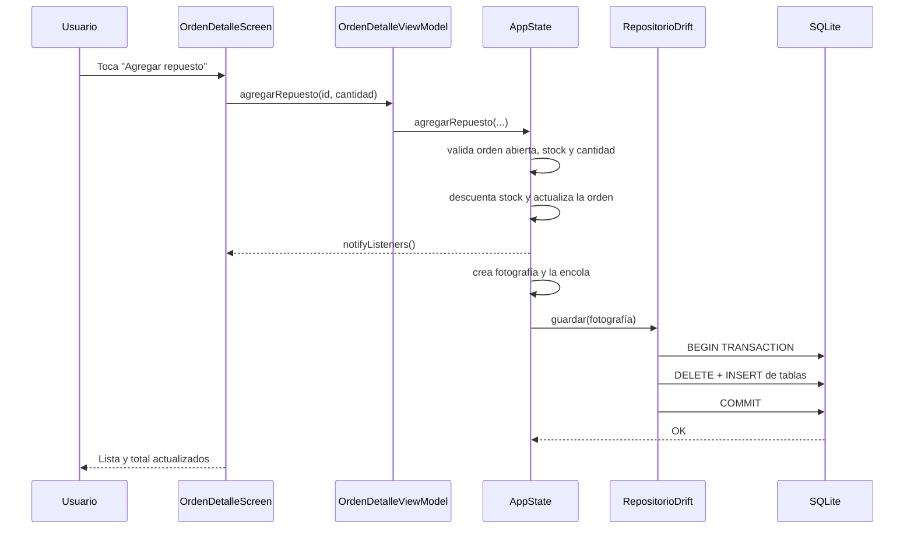

# Arquitectura de El Pistón

Documento técnico complementario del [`README`](../README.md). Explica cómo está organizada la aplicación, por qué se tomaron ciertas decisiones y cómo se relacionan las capas.

---

## 1. Objetivo

El Pistón es una aplicación Android para gestionar un taller automotriz de forma local:

- clientes y sus vehículos;
- órdenes de servicio con estados;
- mecánicos y carga de trabajo;
- mano de obra y repuestos usados;
- inventario con descuento de stock y alertas;
- pagos parciales y deudas;
- reportes operativos y de facturación.

El requisito principal es que **los datos sobrevivan al cierre de la app** y que toda la operación funcione sin conexión.

---

## 2. Capas

```
┌──────────────────────────────────────────────────────────────┐
│  Views (lib/views, lib/widgets)                              │
│  Material 3, formularios, listas, navegación, tema           │
└──────────────────────────────┬───────────────────────────────┘
                               │ ListenableBuilder / callbacks
┌──────────────────────────────▼───────────────────────────────┐
│  ViewModels (lib/viewmodels)                                 │
│  ChangeNotifier: filtros, búsquedas, métricas de pantalla    │
└──────────────────────────────┬───────────────────────────────┘
                               │ acciones y consultas
┌──────────────────────────────▼───────────────────────────────┐
│  AppState (lib/router/app_state.dart)                        │
│  Fuente de verdad, reglas de negocio, reportes, cola de save │
└──────────────────────────────┬───────────────────────────────┘
                               │ DatosTaller (fotografía)
┌──────────────────────────────▼───────────────────────────────┐
│  RepositorioTaller                                           │
│  ├── RepositorioDrift  → Drift → SQLite (producción)          │
│  └── RepositorioMemoria → Map en memoria (pruebas)            │
└──────────────────────────────────────────────────────────────┘
```

### Views

- Construyen la interfaz y reaccionan a los ViewModels con `ListenableBuilder`.
- No contienen reglas de negocio: no calculan saldos, no modifican stock y no validan transiciones.
- Los formularios recogen datos y llaman a métodos de `AppState`; muestran el `String?` de error que devuelve el dominio.

### ViewModels

- Extienden `ChangeNotifier`.
- Se crean en el `initState` de la pantalla correspondiente y se liberan en `dispose`.
- Se suscriben a `AppState` cuando necesitan recalcular datos ante cualquier cambio.
- Transforman el dominio en datos de presentación: listas filtradas, conteos, promedios y agrupaciones.
- No acceden directamente al repositorio.

Ejemplo representativo:

```dart
class OrdenesViewModel extends ChangeNotifier {
  OrdenesViewModel({required this.appState}) {
    appState.addListener(_alCambiar);
  }

  final AppState appState;
  String _texto = '';
  EstadoOrden? _estado;

  List<OrdenServicio> get ordenes {
    // Aplica búsqueda y filtro sobre appState.ordenes.
  }

  void buscar(String texto) {
    _texto = texto;
    notifyListeners();
  }

  void filtrarPorEstado(EstadoOrden? estado) {
    _estado = estado;
    notifyListeners();
  }

  @override
  void dispose() {
    appState.removeListener(_alCambiar);
    super.dispose();
  }
}
```

### AppState

Es un `ChangeNotifier` que concentra el estado del taller y las reglas. Sus listas públicas son la representación en memoria de la base:

```dart
List<Cliente> clientes;
List<Vehiculo> vehiculos;
List<Mecanico> mecanicos;
List<Repuesto> repuestos;
List<OrdenServicio> ordenes;
```

Métodos principales:

- `cargar()`: intenta leer el repositorio; si no hay datos, siembra la demo.
- `persistir()` / `_cambio()`: encola una escritura de la fotografía actual.
- `crearOrden`, `cambiarEstadoOrden`, `agregarManoObra`, `agregarRepuesto`, `registrarPago`: operaciones del flujo principal.
- `guardarCliente`, `guardarVehiculo`, `guardarRepuesto` y sus eliminaciones: ABM.
- `saldoTotal`, `saldoDeCliente`, `facturadoEntre`, `cobradoEntre`, `cargaDeMecanico`: consultas derivadas y reportes.

Las mutaciones devuelven `String?` (o `Resultado<T>` en la creación de órdenes): `null` significa éxito y un texto significa un error de negocio mostrable al usuario.

### Repositorios

`RepositorioTaller` tiene tres operaciones:

```dart
abstract interface class RepositorioTaller {
  Future<DatosTaller?> cargar();
  Future<void> guardar(DatosTaller datos);
  Future<void> cerrar();
}
```

`DatosTaller` es una fotografía inmutable con las cinco listas principales. Esto desacopla el dominio de cualquier detalle de persistencia.

- **Producción:** `RepositorioDrift` abre `BaseDatosTaller` con `driftDatabase(name: 'el_piston')`.
- **Pruebas:** `RepositorioMemoria` guarda la fotografía en una variable y permite simular fallos si fuera necesario.

---

## 3. Flujo de una acción

Ejemplo: agregar un repuesto a una orden.



La UI se actualiza antes de que termine la escritura: la operación es optimista. Si la persistencia falla, la app sigue funcionando en memoria y el error se ignora en `_guardar` para no romper la sesión. Para un taller monousuario es una decisión aceptable; un sistema multiusuario necesitaría reintentos, estado de sincronización y resolución de conflictos.

---

## 4. Persistencia

### 4.1. Cola de escritura

```dart
Future<void> _colaGuardado = Future.value();

void _cambio() {
  notifyListeners();
  final fotografia = _fotografia();
  _colaGuardado = _colaGuardado.then((_) => _guardar(fotografia));
}
```

Ventajas:

- No se solapan transacciones.
- La última fotografía siempre se escribe después de las anteriores.
- Si una escritura tarda, la UI no se bloquea.

Limitación:

- Cada cambio guarda todas las tablas. Con el volumen de un taller pequeño es suficiente; para decenas de miles de filas convendría pasar a operaciones incrementales (`insert`, `update`, `delete` por entidad).

### 4.2. Transacción atómica

`RepositorioDrift.guardar()`:

1. Elimina pagos, repuestos usados, mano de obra y órdenes.
2. Elimina vehículos, clientes, mecánicos y repuestos en un orden compatible con las claves foráneas.
3. Inserta mecánicos, clientes, vehículos, repuestos y órdenes.
4. Inserta mano de obra, repuestos usados y pagos con su posición.
5. Todo ocurre dentro de `transaction()`.

El orden de borrado respeta las restricciones:

- `vehiculos.id_cliente` → `clientes` con `CASCADE`.
- `ordenes` → `clientes`, `vehiculos`, `mecanicos` con `RESTRICT`.
- `mano_obra`, `orden_repuestos`, `pagos` → `ordenes` con `CASCADE`.
- `orden_repuestos.id_repuesto` → `repuestos` con `RESTRICT`.

Por eso las órdenes se borran antes que sus dependencias externas y los repuestos se borran al final.

### 4.3. Integridad referencial

Drift no activa las claves foráneas por defecto en SQLite. La base lo hace en `beforeOpen`:

```dart
@override
MigrationStrategy get migration => MigrationStrategy(
  onCreate: (migrator) async => migrator.createAll(),
  beforeOpen: (details) async {
    await customStatement('PRAGMA foreign_keys = ON');
  },
);
```

Las columnas con referencia usan `customConstraint` explícito para que el DDL generado incluya `NOT NULL REFERENCES ...`. La prueba `test/persistencia_drift_test.dart` verifica que insertar un vehículo con un cliente inexistente falle.

### 4.4. Primer arranque y recuperación

`main()` espera a `AppState.cargar()` antes de `runApp`. Si:

- la base está vacía, se cargan los datos demo y se persisten;
- la lectura lanza una excepción, se ignoran los datos y se vuelve a la demo;
- la escritura falla, la sesión sigue con el estado en memoria.

El splash nativo de Android cubre la espera inicial.

---

## 5. Modelo de dominio

Todas las entidades son clases Dart sin dependencias de Flutter/Drift:

- `Cliente`
- `Vehiculo`
- `Mecanico`
- `Repuesto`
- `OrdenServicio`
- `TrabajoManoObra`
- `RepuestoUsado`
- `Pago`
- `EstadoOrden`

`OrdenServicio` expone cálculos de valor:

```dart
double get totalManoObra => manoObra.fold(0, (t, x) => t + x.precio);
double get totalRepuestos => repuestos.fold(0, (t, x) => t + x.subtotal);
double get total => totalManoObra + totalRepuestos;
double get pagado => pagos.fold(0, (t, x) => t + x.monto);
double get saldo => max(total - pagado, 0);
bool get pagada => saldo < 0.01;
```

Estos getters son de dominio, no de UI. Cualquier pantalla o ViewModel puede usarlos sin duplicar fórmulas.

### Máquina de estados

```
recibida → diagnostico → reparacion → lista → entregada
    │           │             │          │
    └───────────┴─────────────┴──────────┴──→ cancelada

entregada: final
cancelada: final
```

Reglas:

- Solo se avanza al estado `siguiente`.
- Cancelar exige que la orden esté abierta y no tenga pagos.
- Cancelar devuelve stock una sola vez.
- Entregar registra `fechaEntrega`.
- `editable` es verdadero solo para órdenes abiertas.

---

## 6. Reportes

Los reportes no se almacenan: se derivan de las órdenes y pagos cada vez que cambia el estado o el período.

| Cálculo | Fuente |
|---|---|
| Facturado | `ordenes` entregadas con `fechaEntrega` en el rango. |
| Cobrado | `pagos` de órdenes no canceladas con `fecha` en el rango. |
| Saldo | Todas las órdenes no canceladas, sin filtro de fecha. |
| Promedio | Facturado / cantidad de entregadas del rango. |
| Carga por mecánico | Órdenes abiertas por `idMecanico` + entregadas del rango. |
| Deuda por cliente | Suma de saldos de órdenes no canceladas del cliente. |
| Stock bajo | `existencias <= stockMinimo`. |

El rango se interpreta como `[desde 00:00, hasta 23:59:59.999]`; internamente se pasa `hasta + 1 día` a una comparación exclusiva, evitando problemas de milisegundos.

Períodos disponibles:

- últimos 30, 60 o 90 días (incluyendo hoy);
- mes calendario actual;
- rango personalizado, con corrección automática si el usuario invierte las fechas.

---

## 7. Navegación y tema

### Rutas

| Ruta | Pantalla | Ubicación |
|---|---|---|
| `/panel` | Panel | Rama 1 del shell |
| `/ordenes` | Órdenes | Rama 2 |
| `/clientes` | Clientes | Rama 3 |
| `/inventario` | Inventario | Rama 4 |
| `/reportes` | Reportes | Rama 5 |
| `/nueva-orden` | Alta de orden | Ruta raíz |
| `/orden/:id` | Detalle de orden | Ruta raíz |
| `/cliente/:id` | Ficha de cliente | Ruta raíz |
| `/vehiculo/:id` | Ficha de vehículo | Ruta raíz |

El shell usa `StatefulShellRoute.indexedStack`, por lo que cada pestaña conserva su árbol de widgets y su estado. Las rutas de detalle se apilan sobre el shell.

Cada `FloatingActionButton` tiene un `heroTag` único (`fab-panel`, `fab-ordenes`, etc.) porque el `IndexedStack` mantiene los FAB de todas las ramas vivos al mismo tiempo; sin tags únicos, Flutter detecta héroes duplicados al abrir una ruta.

### Tema

`AppTheme` define:

- colores semilla y esquema Material 3;
- tipografía Poppins;
- estilos de tarjetas, inputs, botones y chips;
- variantes clara y oscura.

`TemaScope` es un `InheritedNotifier`/scope que expone `AppThemeController`. El botón de tema cambia `ThemeMode` y `MaterialApp.router` se reconstruye con `ListenableBuilder`.

---

## 8. Pruebas

| Archivo | Tipo | Qué cubre |
|---|---|---|
| `test/app_state_test.dart` | Unitario | Reglas de órdenes, stock, ABM, deudas, reportes demo. |
| `test/viewmodels_test.dart` | Unitario | Búsquedas, filtros, períodos, métricas y acciones. |
| `test/persistencia_drift_test.dart` | Integración | Drift real en memoria, round-trip de datos y FKs. |
| `test/widget_test.dart` | Widget | Navegación por las cinco pestañas. |

La estrategia es inyectar `RepositorioMemoria` en la mayoría de las pruebas para que sean rápidas y deterministas. La prueba de Drift usa `NativeDatabase.memory()` y `BaseDatosTaller.conEjecutor`, sin tocar el teléfono ni el archivo real.

Comandos:

```bash
flutter analyze
flutter test
flutter test test/persistencia_drift_test.dart
```

---

## 9. Decisiones y trade-offs

| Decisión | Motivo | Costo |
|---|---|---|
| Android-only | Requisito y alcance del TP. | No se reutiliza en web/desktop. |
| Drift relacional | Consultas, FKs y transacciones reales. | Requiere generación de código y migraciones. |
| Snapshot completo por cambio | Simplicidad y consistencia. | Más escrituras que un update incremental. |
| AppState central | Una sola fuente de verdad, fácil de testear. | Puede crecer si se agregan muchos módulos. |
| Repositorio abstracto | Tests rápidos e independencia de SQLite. | Una indirección adicional. |
| Precio histórico en la orden | Corrige el total si cambia el precio de lista. | Duplica algunos datos del repuesto. |
| Datos demo al primer arranque | La app se puede evaluar sin carga manual. | Hay que borrar datos para reiniciar la demo. |
| Firma debug en release | Suficiente para instalar y entregar. | No apto para tienda. |

---

## 10. Posibles evoluciones

- Migraciones de esquema versionadas cuando cambie el modelo.
- Persistencia incremental por entidad en lugar de snapshot.
- Autenticación y roles (dueño, recepcionista, mecánico).
- Sincronización con backend y resolución de conflictos.
- Notificaciones de stock bajo y órdenes listas.
- Exportación de reportes a PDF/CSV.
- Firma de producción y publicación en Play Store.
- Tests de integración con `integration_test` en un dispositivo real.
